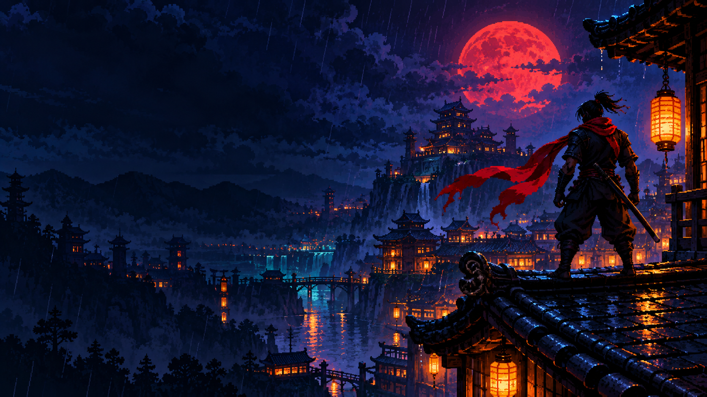

# HAND QUEST

**Suas mãos são o controle.** Demo original de plataforma ninja 2D, inspirada nos arcades dos anos 90, com reconhecimento de duas mãos pela webcam.

**Jogar online:** https://game-air-kohl.vercel.app — público, sem login.



## Jogar localmente

Requisitos: Node.js 22 ou superior, npm, Chrome ou Edge atualizado. Webcam é opcional: há teclado no PC e botões de toque no celular.

```sh
npm ci
npm run dev
```

Abra **http://localhost:5173**. Para jogar por gestos, selecione **Ativar webcam**, autorize a câmera e mantenha as duas mãos visíveis durante a calibração. Se estiver acessando outro computador pela rede, use HTTPS: navegadores bloqueiam webcam em HTTP fora de localhost.

```sh
npm test           # reconhecimento e comandos
npm run build     # TypeScript + build de produção em dist/
npm run preview   # conferir o build local
npx playwright install chromium
npm run test:e2e  # fluxo de navegador e capturas
```

## Controles

| Ação     | Gestos                                        | Teclado             |
| -------- | --------------------------------------------- | ------------------- |
| Andar    | Mão esquerda para os lados; centro para parar | A / D ou ← / →      |
| Pular    | V com a mão direita                           | Espaço              |
| Atacar   | Fechar o punho direito                        | J                   |
| Defender | Palma direita aberta                          | Segurar K           |
| Menus    | Indicador direito sobre botão por 1,2 s       | Mouse / Tab / Enter |
| Pausar   | Botão na tela ou perda de rastreamento        | Esc                 |

**Começar missão não exige manter as duas mãos visíveis no instante do clique.** Se você usar o mouse, a missão espera as mãos voltarem à câmera. O indicador mostra quantas foram detectadas (0/2, 1/2 ou 2/2). A calibração também oferece iniciar sem repetir todo o processo e há uma opção de teclado nas telas de preparação e pausa.

O pulo dispara na entrada do gesto: solte antes de repetir. Manter o punho direito fechado repete ataques a cada 600 ms. Andar e executar uma ação com a direita podem acontecer juntos. A palma aberta mantém a defesa ativa, com movimento mais lento. Não cruze as mãos; fique em local iluminado e evite contraluz. Use **Recalibrar** para ajustar a posição neutra. A prévia funciona como um espelho. Se a câmera identificar os lados ao contrário, use **Trocar esquerda / direita** no painel e calibre novamente. O painel **Visão das mãos** permanece junto da fase e da calibração: mostra a webcam, os pontos e dedos rastreados, a esquerda em âmbar e a direita em verde, além do gesto reconhecido e da contagem de mãos. Em telas estreitas, aparece logo abaixo da fase.

Ao perder uma mão por mais de 1,2 segundo, o jogo pausa. Você pode clicar em continuar e depois devolver as mãos à câmera: a partida espera em segurança e retoma automaticamente, sem exigir outro clique. A permissão inicial da webcam depende da interface do navegador e pode exigir mouse. Menus em dispositivos estreitos são adaptados; há também botões de toque no celular para jogar sem câmera.

## A demo

Uma fase com telhados, saltos, espinhos e abismos; guardas, arqueiros e chefe final. O refúgio no meio da fase recupera até duas vidas e vira ponto de retorno. Derrote o guardião para vencer. A abertura, tutorial, pausa e telas de fim compartilham uma direção visual arcade própria.

## Arquitetura e privacidade

- `src/tracking.ts`: webcam e MediaPipe, apenas um processamento por quadro novo.
- `src/controls.ts`: classificação de poses, suavização, zona neutra e ações de transição.
- `src/game.ts`: Phaser, física, combate, inimigos, fase e animações.
- `src/main.ts`: interface, calibração, pausa, cursor por permanência e fluxo da sessão.

O vídeo é processado **no seu computador**. Nenhum frame é enviado a servidor. Modelo e runtime MediaPipe ficam em `public/`, sem dependência de CDN ao jogar. Fontes também são locais. A câmera encerra ao selecionar **Desligar câmera** ou sair da página. A implementação é uma heurística sobre pontos das mãos, sem treinamento personalizado; o desempenho varia com câmera, iluminação, oclusão e hardware.

## Arte e skills de design

Há quatro folhas de personagens com sete estados de animação, cenário em três planos, obstáculos e metadados de quadros em `public/assets/atlas.json`. A galeria `http://localhost:5173/sprites.html` permite revisar os estados. Para regenerar a arte procedural: instale Pillow (`python -m pip install Pillow`) e rode `npm run assets`. A arte da abertura não é sobrescrita.

As três skills próprias ficam em `.agents/skills/`: direção de arte, sprites/animação e revisão visual. Elas são instruções locais para agentes, não plugins instalados. Consulte [a bíblia visual](docs/ART_DIRECTION.md), [proveniência dos recursos](docs/ASSETS.md) e [validação e limitações](docs/VALIDATION.md).

## GitHub e CI

Repositório de destino: [`vicksa/Game-air`](https://github.com/vicksa/Game-air). A marca do jogo continua **Hand Quest**. A CI configurada executa testes de gestos, build e testes Chromium, e salva as capturas como artefatos. O build pode ser servido como site estático em HTTPS. A configuração e o estado da publicação na Vercel estão em [docs/DEPLOYMENT.md](docs/DEPLOYMENT.md). Uma câmera física ainda deve ser validada no computador do jogador. O projeto não inclui áudio nesta versão.

O rastreamento preserva a identidade das mãos entre quadros e tolera perdas breves na calibração. A câmera solicita 640×480 a 24 fps como preferência. O reconhecimento tenta GPU e usa CPU se a inicialização não for compatível ou se o reconhecimento por GPU falhar durante a sessão. Mostrar uma mão não basta para mover o personagem: os comandos exigem as duas; o painel indica qual está ausente.

### Câmera com pouco ângulo e celular

A mão esquerda funciona como um direcional: mova um pouco e **segure a posição** para continuar andando; volte ao centro calibrado para parar. Fechar o punho esquerdo para sem alterar o centro. Use o botão **Parar / centralizar** para definir um novo centro. O centro é atualizado ao começar ou retomar a missão. Não é necessário acompanhar o personagem com a mão. O controle **Movimento curto** ajusta a sensibilidade de 1× a 3× (padrão 2×). A resposta usa tempo decorrido e uma zona neutra simétrica, sem manter a direção anterior.

A inferência é limitada a 20 quadros/s, com captura preferencial de 640×480 a 24 fps. Se a GPU falhar, o reconhecimento tenta CPU sem desligar a prévia. Vídeo congelado por mais de 2,5 s dispara reconexão, com no máximo duas tentativas consecutivas. Voltar de outra aba retoma o vídeo; a partida pausa ao sair da aba.

No celular, **Jogar com toque** abre a mesma partida com botões simultâneos para andar, pular, atacar e defender. Soltar/cancelar o toque ou sair da aba libera os controles. A precisão dos gestos e o comportamento de recuperação ainda precisam de testes em aparelhos físicos.

### Testes da câmera

`npm run test:camera` executa 15 cenários em Chromium, Firefox sem WebGL e WebKit. Antes da primeira execução, instale os navegadores com `npx playwright install --with-deps chromium firefox webkit`. A suíte usa a fotografia oficial de duas mãos como vídeo local, verifica reconhecimento pelos modelos reais, modo compatível, cancelamento de permissão pendente, fechamento dos tracks e alternativa após permissão negada.

Ao abrir a câmera, a tela mostra a etapa atual e permite cancelar ou escolher **Usar modo compatível**. Esse modo usa TensorFlow.js/WASM com pixels de dimensões reais, sem depender de WebGL; modelos e runtime continuam locais ao site. A escolha também aparece nas falhas de abertura. O carregamento tem prazos para evitar espera infinita; streams que chegarem após cancelar são encerrados.
